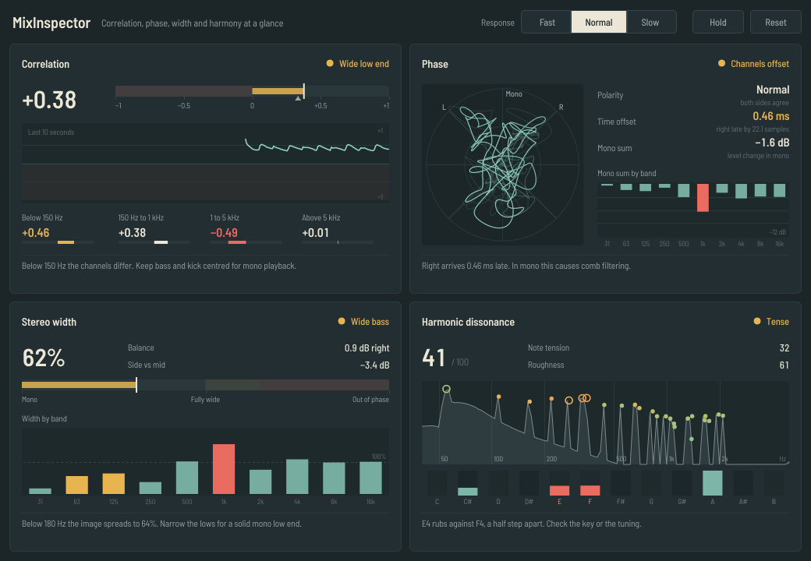
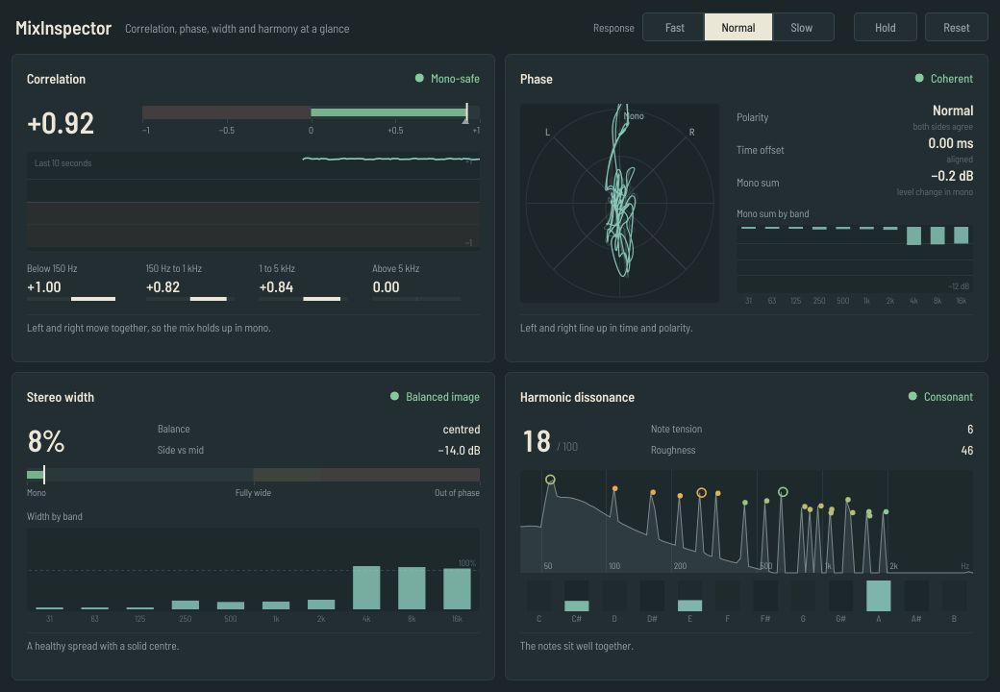

# MixInspector

An audio plugin (VST3, AU and standalone app) that checks four things about a stereo mix while it plays:

| Checker | What it tells you |
|---|---|
| **Correlation** | Do left and right move together? Will the mix survive mono playback? |
| **Phase** | Is one channel's polarity flipped, or is one side arriving late? Where does the mono sum cancel? |
| **Stereo width** | How wide is the image overall and per frequency band? Is the bass spreading out? Does the mix lean to one side? |
| **Harmonic dissonance** | Do the notes being played clash? Which notes rub against each other? |

Every panel gives a short verdict in green, amber or red, plus one plain-language sentence explaining what it means and what to try.



*The same plugin on a healthy mix:*



MixInspector only listens. Audio passes through untouched, and it adds no latency.

---

## Download and install

Ready-made builds for Windows, macOS and Linux are produced automatically by GitHub Actions.

- **Releases page** (recommended): open the repository's *Releases* section and download the zip for your system.
- **Latest test build**: open the *Actions* tab, click the newest green run, and download the file under *Artifacts*. GitHub wraps it in an extra zip, so unzip twice.

Then copy the plugin to your plugin folder and rescan plugins in your DAW:

| System | File | Copy to |
|---|---|---|
| Windows | `MixInspector.vst3` | `C:\Program Files\Common Files\VST3\` |
| macOS | `MixInspector.vst3` | `~/Library/Audio/Plug-Ins/VST3/` |
| macOS (Logic, GarageBand) | `MixInspector.component` | `~/Library/Audio/Plug-Ins/Components/` |
| Linux | `MixInspector.vst3` | `~/.vst3/` |

**macOS note:** the builds are not notarised by Apple, so macOS blocks them the first time. After copying, run this once in Terminal:

```bash
xattr -dr com.apple.quarantine ~/Library/Audio/Plug-Ins/VST3/MixInspector.vst3 ~/Library/Audio/Plug-Ins/Components/MixInspector.component
```

**Standalone app note:** the standalone version analyses your audio *input* (a microphone, or a loopback device that carries your computer's sound). It mutes the input at first to avoid feedback; click *Options*, *Audio/MIDI settings*, and untick *Mute audio input*, or use the *Unmute* button in the banner.

### Where to put it in your session

Put MixInspector **last on the master/stereo bus** to check the whole mix, or on any stereo track or group to check that part alone. Use the *Response* buttons to choose how fast the meters react, *Hold* to freeze the display while you read it, and *Reset* to clear averages after changing something.

---

## Reading the four panels

### Correlation

The classic phase-correlation meter, from −1 to +1, averaged over the response time.

- **+1**: left and right are identical (mono).
- **0**: left and right have nothing in common (very wide, or hard-panned).
- **Below 0**: the channels work against each other and parts of the mix cancel when played in mono.

The small triangle marks the lowest value of the last 3 seconds, so brief dips aren't missed. The graph shows the last 10 seconds. The four numbers below split the measurement into bands (below 150 Hz, 150 Hz to 1 kHz, 1 to 5 kHz, above 5 kHz), because a mix can be fine overall while its low end is not mono-safe.

| Verdict | Rule |
|---|---|
| Mono-safe | correlation 0.3 or higher, and the low band is 0.5 or higher |
| Wide low end | the low band (below 150 Hz) is under 0.5 |
| Very wide | correlation between 0 and 0.3 |
| Out of phase | correlation below 0 |

### Phase

- **Goniometer** (the round scope): a mono signal draws a vertical line, a left-only signal leans to *L*, a right-only signal leans to *R*. A wide mix makes a round cloud; a horizontal line means the channels are out of phase.
- **Polarity**: whether one channel is upside down relative to the other.
- **Time offset**: how much one channel lags the other, in milliseconds and samples. Offsets of even a fraction of a millisecond cause comb filtering when the mix is folded to mono.
- **Mono sum**: how much the level changes when left and right are added together. About 0 dB is ideal, a decorrelated (wide) mix reads around −3 dB, and anything below −6 dB means real cancellation.
- **Mono sum by band**: the same thing in ten octave bands from 31 Hz to 16 kHz, so you can see *where* the cancellation happens.

### Stereo width

- **Width %**: 0% is mono, 100% is fully decorrelated stereo, above 100% means there is more out-of-phase (side) content than centre (mid) content, and 200% means the channels are exact opposites.
- **Balance**: level difference between left and right.
- **Side vs mid**: the level of the side signal relative to the mid signal.
- **Width by band**: width in each octave band. Bands below about 180 Hz turn amber when they spread past 40%, because a wide low end loses punch on mono speakers and on vinyl.

### Harmonic dissonance

MixInspector finds the tonal partials in the mix (using a 0.7-second analysis window, fine enough to tell semitones apart down to about 100 Hz), separates the notes being played from their overtones, and combines two measures into a 0 to 100 score:

- **Note tension** (70% of the score): which intervals the played notes form, independent of octave. Half steps and major sevenths count as most tense, then whole steps and tritones; thirds, fourths and fifths count as smooth.
- **Roughness** (30%): the sensory "beating" between all partials, using the Plomp-Levelt curve in Sethares' formulation. This depends on register, so low, close-voiced chords read rougher (muddier) than the same chord voiced higher.

Typical readings: a single note scores near 0, a fifth around 8, a major or minor triad around 25, a dominant seventh around 45, a tritone around 57, and a half-step clash around 88.

| Verdict | Score |
|---|---|
| Consonant | up to 35 |
| Tense | 35 to 60 |
| Clashing | above 60 |

The spectrum shows the partials it found: rings are played notes, dots are overtones, coloured from green (smooth) to red (rough). The note strip shows which pitch classes are sounding, with clashing notes in red, and the sentence at the bottom names the worst clash (for example "E5 rubs against F5, a half step apart").

Dissonance is a musical choice, not an error. Use this panel to catch accidental clashes such as a bass line out of key, a vocal fighting a pad, or two instruments slightly out of tune with each other.

---

## Building from source

You need CMake 3.22 or newer and a C++17 compiler (Visual Studio 2019+, Xcode 12.4+, or GCC 7+ / Clang 6+). JUCE 9 is downloaded automatically during configuration.

```bash
cmake -B build -DCMAKE_BUILD_TYPE=Release
cmake --build build --config Release
ctest --test-dir build -C Release      # runs the analysis tests
```

The plugins end up in `build/MixInspector_artefacts/Release/`.

On Linux, install the JUCE dependencies first:

```bash
sudo apt install libasound2-dev libfreetype-dev libfontconfig1-dev libx11-dev libxcomposite-dev \
  libxcursor-dev libxext-dev libxinerama-dev libxrandr-dev libxrender-dev libxi-dev
```

To regenerate the screenshots in `docs/`, configure with `-DMIXINSPECTOR_BUILD_SNAPSHOT=ON`, build the `MixInspectorSnapshot` target and run it with an output folder. It feeds the interface with synthetic test mixes and saves PNG files.

### Project layout

```
Source/Core/        analysis engine, plain C++ with no JUCE dependency
  Analyzer.*          correlation, phase, width and dissonance measurements
  FFT.h               small radix-2 FFT
Source/UI/          interface (panels, colours, fonts)
Source/Plugin*.*    JUCE plugin wrapper: audio pass-through and a lock-free FIFO to the UI
tests/              unit tests for the analysis engine (run by ctest and by CI)
tools/TestScenes.h  synthetic test mixes shared by the tests and the screenshot tool
tools/Snapshot.cpp  renders the UI with those mixes to PNG
.github/workflows/  builds Windows, macOS and Linux versions on every push
```

---

## Publishing your own copy on GitHub

1. Create a new, empty repository on github.com (no README, no license; this folder already has both).
2. Upload this folder. Either drag all files and folders into the browser on the new repository page (*uploading an existing file*), or from a terminal inside this folder:

   ```bash
   git init
   git add .
   git commit -m "MixInspector 1.0.0"
   git branch -M main
   git remote add origin https://github.com/<your-name>/<your-repo>.git
   git push -u origin main
   ```

   If you upload through the browser, make sure the hidden `.github` folder comes along; without it there are no automatic builds. On macOS, press Cmd+Shift+. in Finder to show hidden folders.
3. Open the *Actions* tab. The first build starts by itself and takes about 10 to 15 minutes.
4. To publish downloadable builds on the *Releases* page, create a tag that starts with `v`:

   ```bash
   git tag v1.0.0
   git push origin v1.0.0
   ```

   or use *Releases*, *Draft a new release*, and type `v1.0.0` as a new tag.

---

## How the measurements work

All analysis runs on the editor's thread, never on the audio thread, and only while the window is open. The audio thread copies samples into a lock-free FIFO and returns.

- **Correlation, width, balance, mono sum** come from exponentially averaged energies of L, R and L·R (time constants 0.1, 0.3 or 1 s). Width is `1 − 2·E[LR] / (E[L²] + E[R²])`, which equals `1 − correlation` when the channels are balanced.
- **Per-band values** come from cross-spectra of an 8192-point FFT (at 44.1/48 kHz; the size scales with the sample rate) summed over each band.
- **Time offset and polarity** use GCC-PHAT on a 1.5-second averaged cross-spectrum, weighted by coherence so wide, decorrelated parts of the mix don't hide the part that left and right share. A non-zero offset is only reported when its peak clearly beats zero lag, so chorused or phase-spread sounds don't trigger false alarms. The sign of the correlation peak gives the polarity.
- **Dissonance** uses a 32768-point FFT of the mono sum, peak picking with a median-based noise floor, overtone grouping, octave-equivalent interval tension, and Plomp-Levelt roughness.

The tests in `tests/CoreTests.cpp` check these against signals with known answers: delays measured to within half a sample, polarity detection, band splits, the ranking of musical intervals at 44.1, 48 and 96 kHz, and two complete test mixes (one healthy, one with an offset channel, wide bass and an E/F clash) that must produce the right verdicts.

---

## License

MixInspector is built with [JUCE](https://juce.com), which is used here under the GNU AGPLv3, so MixInspector is licensed under the **GNU Affero General Public License v3** as well (see `LICENSE.md`). If you share builds, share the source too.

The interface font is [Barlow](https://github.com/jpt/barlow) by Jeremy Tribby, licensed under the SIL Open Font License 1.1 (see `Resources/Fonts/OFL.txt`).

VST is a trademark of Steinberg Media Technologies GmbH. Audio Units is a trademark of Apple Inc.
